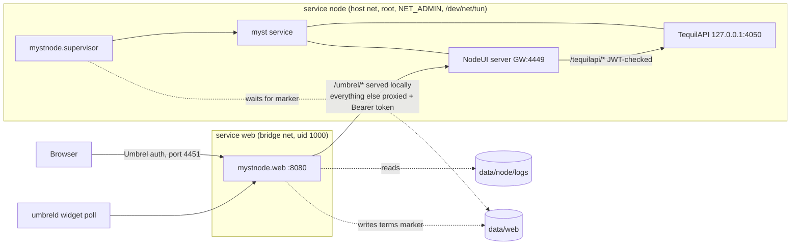

# Mystnode

An Umbrel community-app-store app that runs a **Mysterium Network node**
(`mysteriumnetwork/myst` 1.39.7) on umbrelOS 2.0, with its own dashboard for
running the node from the Umbrel home screen. The stock Mysterium NodeUI is one
click away and already signed in.

- Store id: `mystnode` · App id: `mystnode-mysterium` · Port: `4451`
- Target: umbrelOS 2.0 on `linux/amd64` and `linux/arm64`
- Image: `ghcr.io/cooperwang-py/mystnode:1.39.7`, built on `mysteriumnetwork/myst:1.39.7-alpine`

## Your Umbrel becomes an exit node

Read this before installing. A Mysterium node is an **exit node**: other people's
VPN, B2B data-transfer and scraping traffic leaves the internet through **your
home IP address**. To do that the node runs with host networking and
`NET_ADMIN`, and changes the host's firewall (iptables) and network interfaces.

The node does not start until you accept Mysterium's
[exit node terms](https://github.com/mysteriumnetwork/node/blob/master/TERMS_EXIT_NODE.md)
and [end user terms](https://github.com/mysteriumnetwork/node/blob/master/TERMS_END_USER.md)
in the app. Later versions of the terms are accepted automatically when the node
updates.

## Install

1. In umbrelOS, open the **App Store**, then the **⋮** menu → **Community App
   Stores**.
2. Add this repository URL:

   ```
   https://github.com/CooperWaNg-py/mystnode
   ```

3. Install **Mysterium Node** from the Mystnode store that appears.
4. Open it, accept the terms, and wait about a minute for the node to start.

The dashboard has these tabs:

| Tab | What it does |
|---|---|
| Overview | Version, identity, NAT type, monitoring, quality, uptime; setup checklist (registration, mystnodes.com claim, payout wallet); earnings summary |
| Services | Switches VPN (dVPN), Public (WireGuard), B2B data transfer and B2B data scraping on and off. Changes persist. |
| Earnings | Balances, earnings by service, a 30-day chart, **Settle now**, payout wallet, settlement history |
| Sessions | All-time totals, 30-day traffic, paged session list |
| Settings | Log level, UDP port range, bandwidth limit, **Restart node** |
| Logs | The node log with level filter, auto-refresh and download (works while the node is down) |

It also adds a `four-stats` home-screen widget (node status, running services,
unsettled and lifetime MYST, refreshed every 30 s).

Umbrel shows a password for the app (username `myst`). That is the NodeUI
password; you only need it if NodeUI ever shows its own login page.

## How it fits together



- **Two services, one image.** `node` runs `mystnode.supervisor`, which runs the
  upstream `docker-entrypoint.sh … service`. `web` runs `mystnode.web`, the
  dashboard and the `app_proxy` target.
- **TequilAPI stays on `127.0.0.1:4050`.** Desktop `myst` never authenticates
  it (`tequilapi/http_api_server.go` only enables JWT when
  `TequilapiSecured` is set, and only the mobile build sets it), so it is never
  exposed. The web service reaches the node only through NodeUI's
  `/tequilapi/*` proxy, which checks a JWT.
- **NodeUI binds only to the Docker host-gateway address** (`--ui.address`),
  never the LAN. Both services resolve it as `host.docker.internal`
  (`extra_hosts: host-gateway`).
- **One origin.** NodeUI's page uses absolute `/static/…` and `/tequilapi/…`
  URLs, so it owns `/`; the dashboard lives under `/umbrel/` (the manifest's
  `path`). Every other path is proxied to NodeUI with a Bearer token injected, so
  the browser never holds a node credential.
- **The NodeUI password is Umbrel's `APP_PASSWORD`.** The supervisor writes its
  bcrypt hash to `data/node/nodeui-pass` and re-checks it every 15 s. myst reads
  that file on every login, so a password changed inside NodeUI is reverted and
  cannot lock the dashboard out.
- **Terms gate.** The supervisor waits for `data/web/terms-accepted.json`,
  written by the dashboard, then always starts myst with
  `--agreed-terms-and-conditions`.
- **Restarts.** "Restart node" calls TequilAPI `POST /stop`. myst 1.39.7 exits
  with code 1 after that (its API listener close is reported as an error), so
  the supervisor exits too and Docker's `restart: on-failure` starts the
  container again. A clean exit (code 0) is restarted in place by the
  supervisor.
- **Request gates.** The web service answers only the host (umbreld proxies and
  polls widgets from the bridge gateway), so other app containers on Umbrel's
  network cannot drive the node. Requests that change state must come from this
  origin (`Sec-Fetch-Site`), the same rule as
  [umbrel-wine](https://github.com/CooperWaNg-py/umbrel-wine). NodeUI's
  permissive CORS headers are stripped.

## Local development

### Tests

```bash
python3 -m venv .venv && .venv/bin/pip install bcrypt
.venv/bin/python -m unittest discover -s image/tests -v
```

The tests run the supervisor against fake entrypoint scripts and the dashboard
against a fake NodeUI (`image/tests/fakenode.py`); no Docker or network is needed.

### Dev stack

`tools/dev-stack.yml` runs both services outside umbrelOS, with the dashboard
published on `localhost:8080` and **no authentication**. Host networking needs a
Linux Docker host or a VM-backed runtime such as Colima or OrbStack:

```bash
mkdir -p appdata/node/logs appdata/web
sudo chown -R 1000:1000 appdata/web appdata/node/logs   # Linux hosts
# Colima / OrbStack / Docker Desktop only: host-gateway is the Mac there, which
# the VM cannot bind, so use the VM's docker0 address instead.
export MYSTNODE_DEV_GATEWAY=172.17.0.1
docker compose -f tools/dev-stack.yml up -d --build
docker compose -f tools/dev-stack.yml logs -f node
# browse to http://localhost:8080/umbrel/
```

The dev password is `devpassword-change-me`.

## Building and publishing the image

The image must be a multi-arch manifest list; umbrelOS runs on `linux/amd64`
and `linux/arm64`, and the app linter rejects single-arch images.

`.github/workflows/publish-image.yml` runs the unit tests and publishes the image
on every push to `main` that touches `image/`. Manual equivalent:

```bash
docker buildx build --platform linux/amd64,linux/arm64 \
  -t ghcr.io/cooperwang-py/mystnode:1.39.7 --push image/
docker buildx imagetools inspect ghcr.io/cooperwang-py/mystnode:1.39.7
```

Copy the reported **index** digest into both services in
`mystnode-mysterium/docker-compose.yml`
(`ghcr.io/cooperwang-py/mystnode:1.39.7@sha256:<index-digest>`). A package
pushed to GHCR is private by default: make it public once at
`github.com/users/CooperWaNg-py/packages/container/mystnode/settings`, or
umbrelOS cannot pull it.

Bump `version` in `mystnode-mysterium/umbrel-app.yml` only in the same commit
as, or after, the new digest; umbrelOS compares only that version when it offers
updates.
